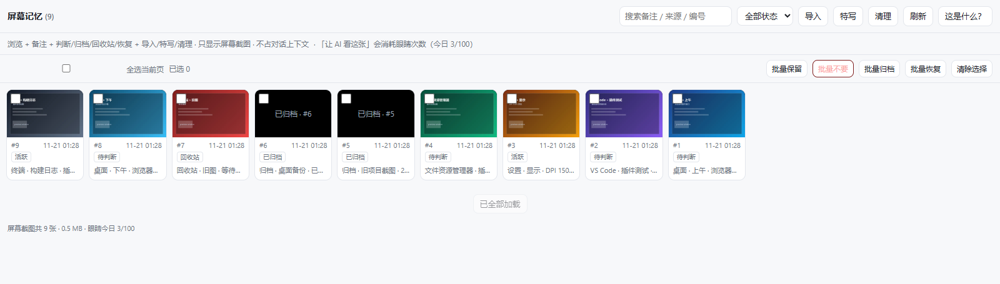
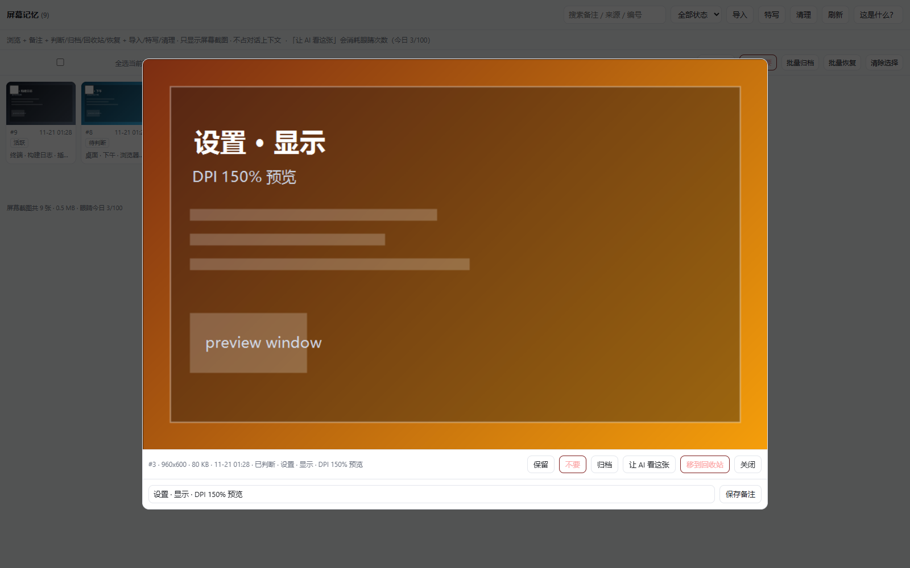
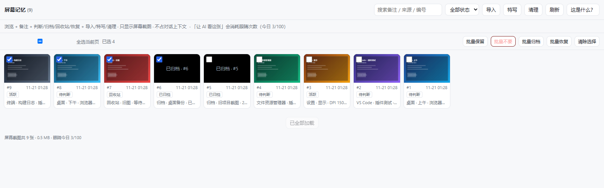
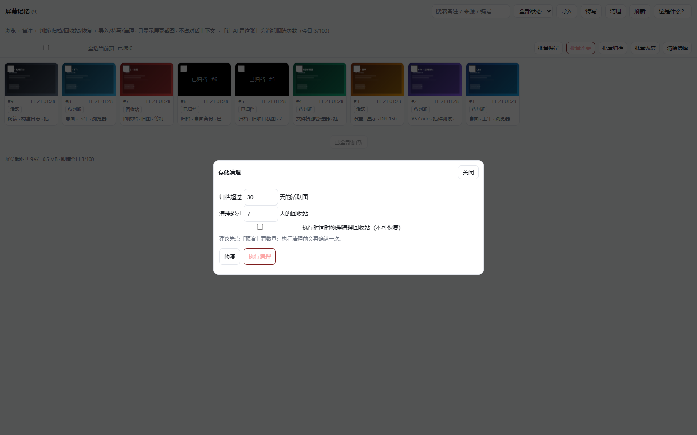
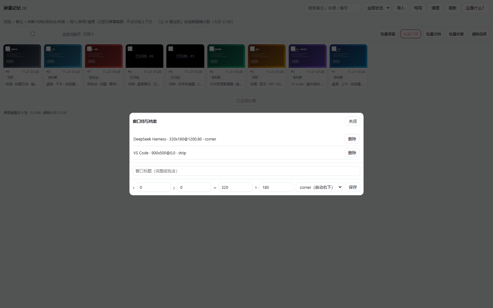
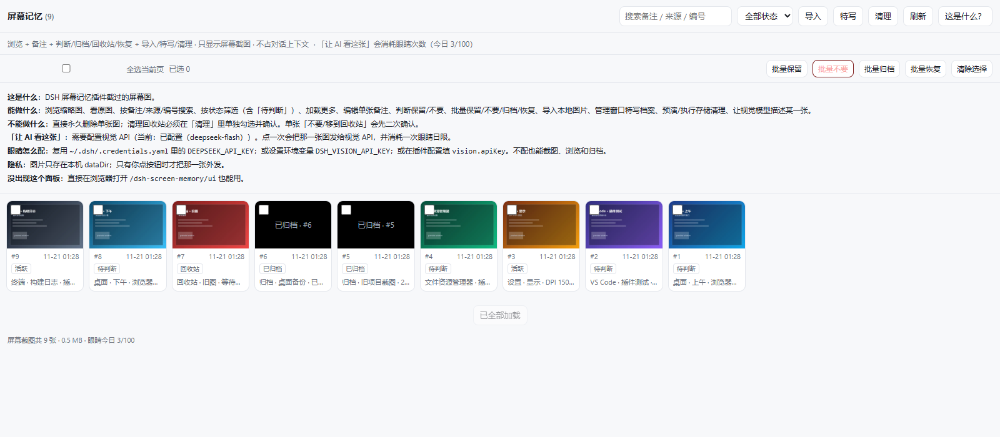

# DSH Screen Memory 宣传文案与配图

> 配图为 UI 演示环境截图，使用示例数据；真实数据只存在本机。

## 一句话

**把屏幕截图变成一个能搜索、能判断、能归档、还能被 AI 回看的本地图片仓库。**

## 短版简介

DSH Screen Memory 给 DeepSeek Harness 加了一双“记得住”的眼睛：截整屏、指定窗口或区域特写，存进本地图片仓库；按时间、备注、来源和状态找回来；需要理解画面时，让视觉模型把图转成文字，而不是把原图直接塞进聊天上下文。

## 长版简介

普通的截图工具把图片丢进一个文件夹，时间一长就再也找不到。  
DSH Screen Memory 把截图当成一份可管理的数据：

- 内容寻址存储，同一张图只存一份；
- SQLite 索引，图片多了也能按状态、来源、时间翻页；
- 备注、判断、回收站、归档、恢复形成完整生命周期；
- 归档不是删除：原图进入 `tar.gz`，需要时还能恢复；
- 眼睛只把画面转成文字，主会话不必为每张图付图片 token；
- 本地优先：图片只在本机，只有你主动调用眼睛时才外发。

## 新颖和突出的地方

### 1. 不是“截图文件夹”，是图片仓库

```
内容寻址 blob + SQLite 索引
同一张图只存一份
按时间 / 备注 / 来源 / 编号 / 状态检索
```

### 2. 眼睛是“上下文防火墙”

```
screen_look      → 截图入库，返回编号/路径
screen_describe  → 图片发给视觉 API，只拿回文字
read_image       → 只有确实需要看原图时才进入上下文
```

这让“看屏幕”从“每张图都塞进对话”变成“先查目录，必要时再看图”。

### 3. 截图有完整的生命周期

```
hot → 判断保留/不要 → 回收站 → 手动清理
hot → 归档 → tar.gz → screen_get 恢复
```

不是只能“截图”和“删除”两个动作。

### 4. 仓库 UI 是完整工作台

```
缩略图网格 / 搜索 / 状态筛选 / 加载更多
单张详情 / 备注 / 保留 / 不要 / 归档 / 恢复
批量选择 / 批量动作
导入本地图片 / 窗口特写档案 / 存储清理
```

### 5. 本地优先，不常驻、不开端口

```
图片只在本机
不注册全局 hook
不开后台端口
定时器 unref
```

### 6. 为 DSH 原生设计

```
11 个 screen_* 工具
右侧栏仓库面板 + 独立页面
首次使用有 status.setup / doctor / UI 配置引导
```

## 配图

### 01. 仓库总览



> 缩略图、状态、时间、备注一屏可见；支持搜索、筛选、批量与加载更多。

### 02. 单张详情



> 原图、尺寸、时间、备注和操作都在同一张卡片里；看图前可以先判断值不值得。

### 03. 批量操作



> 一次选择多张，批量保留、不要、归档或恢复。

### 04. 存储清理



> 归档多久前的图、清理多久前的回收站，先预演再执行；物理清理需要单独确认。

### 05. 窗口特写档案



> 记住某个窗口的区域和摆放位置，下次截图自动套用；适合固定面板、游戏 HUD 和常看的窗口。

### 06. 内置说明与眼睛配置



> 不把用户丢在报错里：没有视觉 API 时，界面直接给出三种配置方式；不配也能截图和用仓库。

## 建议的 GitHub 仓库简介

```
给 DSH 的本地屏幕记忆：截图 / 窗口 / 特写 → 内容寻址图片仓库 → 搜索、判断、归档、恢复；眼睛只回文字，不把原图塞进上下文。
```

## 建议的 Market 卡片文案

**DSH Screen Memory — 给 AI 一双记得住的眼睛**

截屏、窗口、特写统一进本地图片仓库；支持搜索、备注、判断、批量、归档恢复和存储清理。需要理解画面时，让眼睛把图转成文字，避免原图占满上下文。Windows 截图，数据本地保存，眼睛可选。

## 社交平台短文案

### 版本 A（偏功能）

```
给 DSH 做了个屏幕记忆插件：
截图 → 本地图片仓库 → 搜索/判断/归档/恢复。
最特别的是“眼睛”：图片发给视觉模型，主会话只拿回文字，
不用把每张截图都塞进上下文。
Windows 可用，数据只在本机。
```

### 版本 B（偏场景）

```
以前截图是“先存着，以后再说”，
现在是“存进去，找得到，判断得了，归档还能恢复”。

DSH Screen Memory：
整屏 / 窗口 / 特写
内容寻址 + SQLite 索引
仓库 UI + 批量操作
眼睛只回文字，不占图片上下文
```

### 版本 C（一句话）

```
截图不是终点，能翻回来才是。
DSH Screen Memory：把屏幕画面变成可搜索、可归档、可回看的本地图片仓库。
```

## 英文短版

**DSH Screen Memory — a local, searchable visual memory for DeepSeek Harness.**

Capture the full screen, a window, or a close-up region, then keep it in a content-addressed local warehouse with notes, review states, batch actions, tar.gz archiving and restore. When the model needs to understand a frame, the Eyes tool turns it into text instead of pushing the original image into the chat context. Windows capture, local-first storage, optional vision API.

## 发布时不要写错的点

```
· 截图仅 Windows；仓库和眼睛对已有图片可跨平台使用
· 不配视觉 API 也能截图、浏览、归档；只是 screen_describe 不可用
· 眼睛会把图片发给配置的视觉 API，不是纯本地
· 回收站不是自动 7 天删除；定时任务默认不清理，手动整理才会物理清理
· 归档不是删除原图；tar.gz 可恢复，但仓库目录被手动删掉就没了
```
